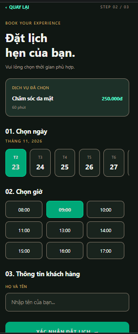
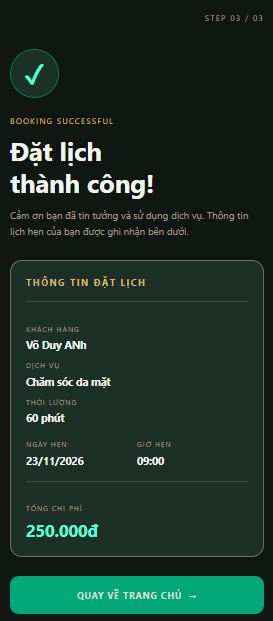

## 1. Link ứng dụng Expo

- **Tên bài nộp:** BookingApp
- **Link Expo Snack:** [BookingApp](https://snack.expo.dev/@voduyanh/bookingapp)

## 2. Các dòng code và hình ảnh giao diện

### 2.1. Component ServiceCard

**File:** `components/ServiceCard.js`

Hiển thị thông tin dịch vụ gồm hình ảnh, tên dịch vụ, thời lượng và giá tiền.

**Code sử dụng trong HomeScreen:**

```jsx
<ServiceCard
  key={item.id}
  service={item}
  onPress={() =>
    navigation.navigate('ServiceDetail', { service: item })
  }
/>
```

**Hình ảnh giao diện:**


### 2.2. Component DateSelector

**File:** `components/DateSelector.js`

Hiển thị danh sách ngày để người dùng lựa chọn ngày đặt lịch.

**Code sử dụng trong BookingScreen:**

```jsx
<DateSelector
  dates={dates}
  selectedDate={selectedDate}
  onSelect={setSelectedDate}
/>
```

**Hình ảnh giao diện:**



### 2.3. Component TimeSlot

**File:** `components/TimeSlot.js`

Hiển thị các khung giờ để người dùng lựa chọn giờ đặt lịch.

**Code sử dụng trong BookingScreen:**

```jsx
<TimeSlot
  times={times}
  selectedTime={selectedTime}
  onSelect={setSelectedTime}
/>
```

**Hình ảnh giao diện:**


### 2.4. Component BookingSummary

**File:** `components/BookingSummary.js`

Hiển thị thông tin tổng hợp của lịch hẹn sau khi xác nhận.

**Code sử dụng trong ConfirmationScreen:**

```jsx
<BookingSummary
  service={service}
  customerName={customerName}
  selectedDate={selectedDate}
  selectedTime={selectedTime}
/>
```

**Hình ảnh giao diện:**



### 2.5. Các màn hình của ứng dụng

**HomeScreen**


**ServiceDetailScreen**


**BookingScreen**


**ConfirmationScreen**

